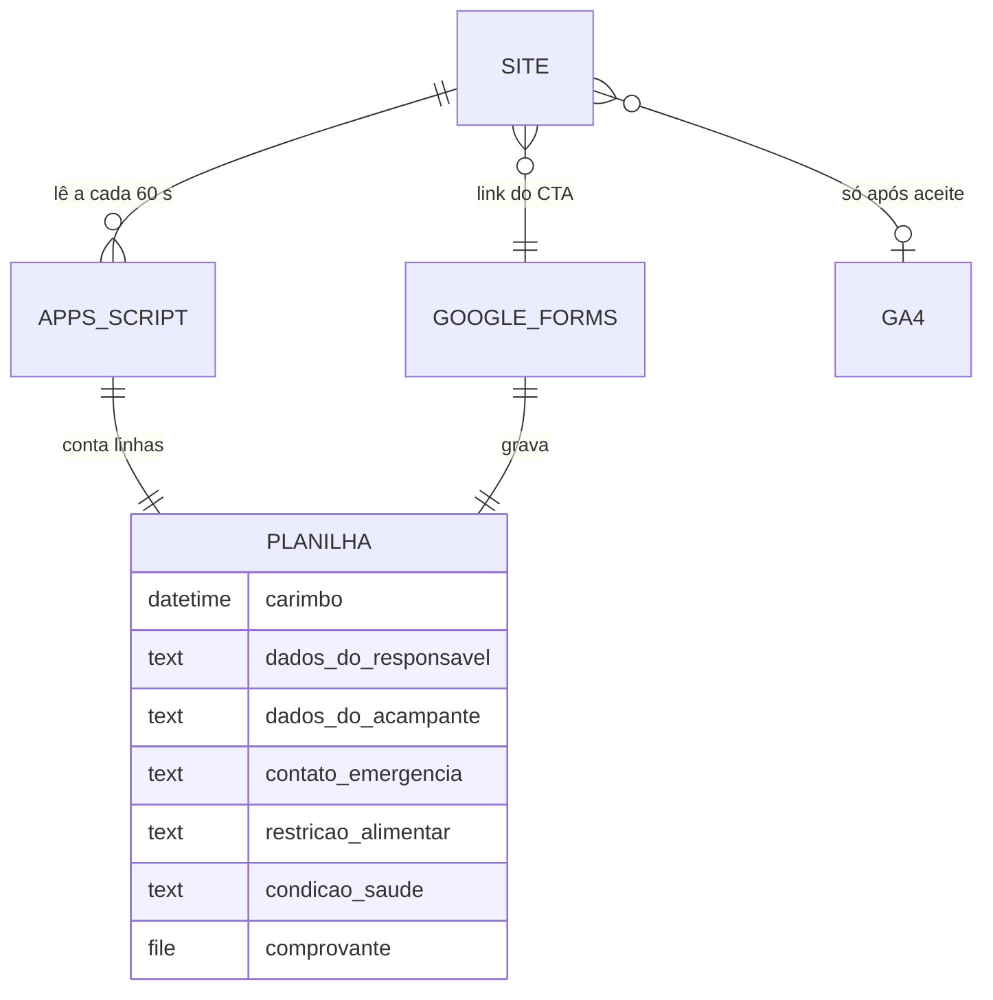

# SCHEMA.md — Together Camp 2026.2

> O site não guarda dado pessoal nenhum. Não há banco, formulário nem login. Este arquivo registra para onde os dados vão e o que o site lê.

## Entidades (fora do site)

| Entidade | Onde vive | Campos | Quem acessa | Retenção (LGPD) |
| --- | --- | --- | --- | --- |
| Pré-inscrição | Google Forms → planilha, aba "Respostas ao formulário 1" | responsável legal (nome, celular, parentesco, documento, e-mail), acampante (nome, nascimento, sexo, celular, documento), contato de emergência, restrição alimentar, condição de saúde, comprovante de pagamento | só a liderança, na conta Google dela | [A CONFIRMAR] sugerido: apagar dados de saúde até 30 dias após o evento; demais até 12 meses |
| Contador de vagas | Apps Script publicado na mesma planilha | devolve só `{inscritos, vagas, atualizado}` | qualquer pessoa com a URL (número apenas) | cache de 60 s; nada é armazenado |
| Consentimento de cookies | `localStorage` do navegador do visitante (`tc-consent`) | "yes" ou "no" | só o próprio navegador | até o visitante limpar os dados |
| Analytics (quando ligado) | GA4, conta da igreja | visitas, cliques em inscrição/WhatsApp/compartilhar | administradores do GA4 | padrão do GA4 (14 meses) |

## Diagrama

## Cuidados
- A planilha tem dados sensíveis de menores (saúde). Nunca compartilhar como "qualquer pessoa com o link". O script publicado expõe só o número.
- Recomendação à liderança: incluir no formulário um parágrafo sobre finalidade, acesso e prazo de guarda dos dados (LGPD, art. 14 para menores).
- Sem chave service role, sem segredo em código: não há o que vazar do lado do site.
